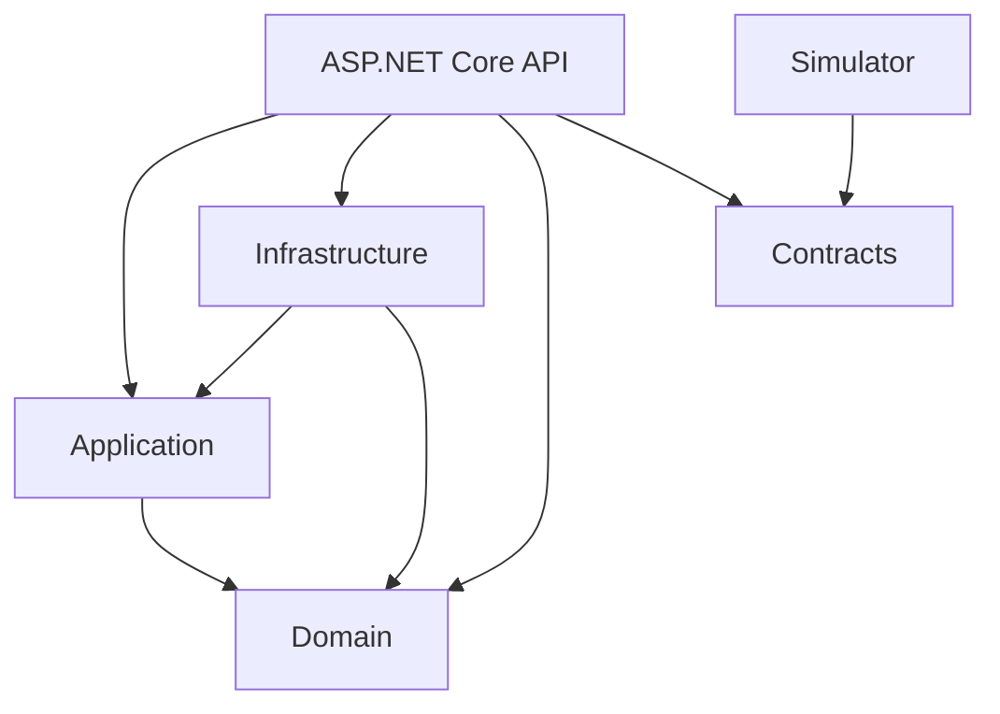

# Architecture and milestone decisions

## Boundaries



Arrows represent C# project references. Domain and Contracts have no project or
package dependencies. Application has no framework dependencies. Infrastructure
implements application storage boundaries. SignalR types
stay in the API. The simulator cannot access backend state or domain rules.

Application owns command/query handlers and `ITrackingStore`. Infrastructure supplies
`InMemoryTrackingStore`; Contracts holds telemetry requests and snapshot responses.
Domain validates immutable GPS samples, including finite values and explicit units.
Controllers map transport data and delegate processing to Application.
All concrete API controllers inherit `[ApiController]` and the shared
`api/[controller]` route from abstract `BaseApiController`. Actions retain their
HTTP verb and resource-specific suffix attributes. URLs remain `/api/health`,
`/api/vehicles` and `/api/vehicles/{id}/samples`; method names are not URL segments.
Response formatters select JSON or ProblemDetails content types without a global
`Produces` override. Shared client URL constants remain in Contracts.
The sample controller maps requests to an application command and delegates to
`SubmitSampleHandler.HandleAsync`. That operation validates domain sample creation
and returns a typed acceptance result. API mapping extensions translate snapshots
and acceptance results into transport DTOs and HTTP responses. Domain validation
bounds/messages and API response messages live in constants owned by their layers.
`TaskExtensions.ToOkResult` supports both plain values and asynchronous results.
GET controllers use it. Reads stay synchronous; ingestion awaits best-effort
publication after storing a sample. Ingestion retains 204 and errors retain their
ProblemDetails status.
Startup tracking validation messages and count/threshold limits live in
`TrackingValidationConstants`; coordinate limits reuse domain constants.
The built-in `UseExceptionHandler` middleware runs before CORS and controllers,
using the registered ProblemDetails service for unexpected request failures.
It returns generic 500 responses in Development and Production while framework
logging retains exception diagnostics. Expected 400/404/409 results keep their
explicit mappings. No custom exception middleware or duplicate logging is needed.

All application projects live under `src/`; the solution and repository-wide
configuration remain at the root:

```text
src/
  GpsTracking.Domain/
  GpsTracking.Application/
  GpsTracking.Infrastructure/
  GpsTracking.Api/
  GpsTracking.Contracts/
  GpsTracking.Simulator/
  gps-tracking-web/
docs/
GPS-Vehicle-Tracking-Simulator.sln
```

This is a pragmatic Clean Architecture variant. Domain holds business concepts
and rules. Application owns use cases and the interfaces those use cases need.
Infrastructure implements those interfaces. API is the delivery layer and
composition root: it registers Infrastructure implementations, while controllers
delegate business operations to Application. Neither Domain nor Application
references API, Infrastructure, HTTP, SignalR or persistence frameworks.

Contracts contains transport DTOs shared by the API and simulator; it must not
become a home for business logic or a dependency of Domain. The simulator and
Angular UI are independent clients. Future rule tests belong under a root
`tests/` directory when the corresponding behavior is implemented.

The API's Infrastructure reference is needed for composition, not permission for
controllers to bypass Application. Dependency direction defines the architecture;
the consistent directory layout makes it easier to navigate. No mediator or
CQRS framework is required to maintain these boundaries.

Lightweight CQRS is implemented in Application's `Tracking/Commands` and
`Tracking/Queries`. The combined `TrackingService` has been removed; controllers
invoke handlers directly. Commands cover sample ingestion and settings mutations,
while queries provide snapshots, settings, alerts and geofence definitions. Reads
and writes use the existing in-memory store. Commands may return result snapshots.
Domain rules, atomic processing and publication outside storage gates remain
intact. No MediatR, separate databases or event sourcing are needed.

## Current behavior

Each host owns a service-registration extension named `AddServiceCollection`.
Options binding and validator registration
live in these extensions. HTTP middleware and endpoint mapping stay visible in
the API's `Program.cs`. Composition remains in the hosts so the inner layers do
not require dependency-injection framework packages.

Stable API identifiers live in `GpsTracking.Api/Constants/ApiConstants.cs`;
frontend display constants live in `gps-tracking-web/src/app/core/constants/`.
Constants belong to their owning layer. Configuration section names remain with
their options types. URLs, vehicle settings and seed definitions remain in
configuration so constants do not prevent runtime configuration in later milestones.

Custom startup summary logging is omitted. Standard host lifecycle and error logs
remain enabled; `ValidateOnStart` still rejects invalid configuration in both
hosts. No ORM is selected or installed: M1 uses in-memory storage, and database
persistence remains outside the agreed scope.

- The API binds and validates two vehicle definitions, their independent initial
  settings, and two geofence rectangles. It exposes health, development OpenAPI,
  ingestion, snapshots, alerts, live settings and geofence reads. Geofence definitions
  are fixed at startup; their membership is evaluated for each accepted sample.
- Domain records represent seed values without depending on ASP.NET Core or
  configuration packages. API options and validators own startup binding.
- The simulator's .NET generic host validates its backend URL, minimum interval,
  and two distinct IDs. It runs independent asynchronous loops, advancing routes
  by monotonic elapsed time with UTC timestamps. HTTP timeout is five seconds;
  failed samples are skipped without retries or catch-up bursts.
- Angular uses typed HTTP services, a SignalR connection service and a signal-backed
  store. Initial connection and reconnection trigger REST synchronization with a
  five-second timeout. Failures preserve displayed data and trigger retries.
  There is no regular snapshot polling. SVG markers use distinct colors
  and heading arrows within fixed demo bounds. No stop status is inferred.

Frontend feature services use the shared `ApiService` in `core/services` for
GET/POST/PUT/PATCH/DELETE requests. `TrackingApiService` owns tracking endpoints and
response types. The shared wrapper preserves HttpClient errors and body handling,
including FormData, without forcing headers or adding retries. Synchronization and its
timeout/error presentation remain owned by `TrackingStore`. Extend this wrapper
when a future feature requires additional HTTP capabilities.
Frontend application error messages live in `core/constants/error-messages.constants.ts`.
Settings forms use named validation messages and limits in `settings.constants.ts`.
Request timeouts and map bounds
already live in tracking constants. Backend error bodies remain unmodified by
the shared HTTP wrapper.

`POST /api/vehicles/{id}/samples` accepts timestamp, latitude, longitude, speedKmh
and heading. The route is the sole vehicle identifier. Success is 204; invalid
payloads return 400, unknown vehicles 404 and non-newer timestamps 409, using
ProblemDetails. Supplied speed and heading remain authoritative.

The singleton store retains raw samples under one shared state lock in M5.
Timestamp acceptance, append, receipt time and revision increment are atomic.
Reads return immutable snapshot copies, with null latest data before the first
sample. The synchronization query captures both vehicles and global settings together.
M5 exposes raw history and separate route segments. Backend restart clears the session;
browser refresh reads the existing session.

### M2 live synchronization

`AppendWithSnapshot` captures the accepted vehicle revision under the storage lock.
Application publishes that immutable snapshot through `ITrackingPublisher` after
the lock is released. The API's SignalR adapter broadcasts `VehicleUpdated` through
`IHubContext<TrackingHub>`, with a five-second cancellation timeout, and logs transport
failures without undoing telemetry. There is no durable event queue or replay.

`GET /api/vehicles` returns `{ sessionId, vehicles }`; a live event contains
`{ sessionId, vehicle }`. The process-lifetime session UUID is shared by REST and
SignalR. Revisions are comparable only within one session. This changes the M1
snapshot response shape; simulator POST payloads are unchanged.

The frontend registers handlers before connecting, connects before reading REST,
and buffers the newest event per vehicle/session while REST is pending. It merges
only newer revisions, replaces state when REST identifies a new session, and
ignores events from another session. Reconnection cancels old requests and starts
fresh synchronization. Failed REST requests retry after two seconds; initial
connection failures retry separately from SignalR's automatic reconnect policy
(0, 2, 5, then 10 seconds repeatedly). Stop cancels requests/timers and detaches
event handlers; identity/generation guards ignore obsolete asynchronous callbacks.
Live connection state is separate from vehicle freshness; M2 does not infer stops
or mark stationary data as stale.

### M3 speeding and settings

`SpeedingRule` is plain C# in Domain. Supplied speed must be strictly above the
limit for the full GPS timestamp duration: 00/10/20/30 seconds qualifies at 30.
Equality or a lower speed ends the episode. One alert is recorded per episode.
Alerts distinguish GPS occurrence time from backend creation time and retain the
thresholds that produced them.

Sample ingestion and vehicle settings changes use the same shared storage
gate. Settings changes reevaluate only the latest continuously qualifying suffix
of retained samples. A 30-to-15-second change after 20 seconds can immediately
produce an alert at the latest GPS timestamp. An already-alerted qualifying state
keeps its latch; invalidating that state rearms it. Stop-duration-only changes do
not reevaluate speeding. Settings updates can advance revision without adding a
sample, so revision and sample count are separate concepts.

`GET /api/vehicles` also includes global settings. Each vehicle snapshot includes
settings and cumulative alert history. `GET /api/alerts` exposes the session's
combined history. `GET /api/vehicles/{id}/settings` returns a vehicle snapshot;
`PUT` returns its session-tagged event. `GET`/`PUT /api/settings` return a global
settings event with an independent revision. Global radius defaults to 10 metres
and uses the shared storage gate in M5. Stop duration and radius are applied to
spatial processing and coordinated stop reevaluation.

Publication occurs after locks are released. Vehicle settings and alerts reuse
`VehicleUpdated`; global edits publish `GlobalSettingsUpdated`. Carrying cumulative
alerts avoids a separate alert delivery/replay mechanism and recovers missed alerts
through REST synchronization. This trades simplicity for increasing payload size
and memory use during long sessions. Angular merges alerts by ID independently of
vehicle revision and resets history when the backend session changes.

Reactive forms use `@angular/forms` 22.2.3. Dirty drafts survive live updates;
successful saves use the latest known revision, failed saves retain input, and
duplicate submissions are blocked while a request is pending. Concurrent clients
use last-write-wins settings. Backend restart restores configured defaults and
clears alerts; browser refresh preserves backend state.

### M4 geofencing

Each vehicle session owns one Domain `GeofenceRule` per configured rectangle.
The rule retains at most three booleans and an Unknown/Inside/Outside membership.
Rectangle comparisons include edges. Three observations initialize the majority
without an alert; subsequent majority changes create entry/exit alerts at the
confirming GPS timestamp. Only accepted observations advance the windows. Settings
changes do not reset geofence state. No geometry interpolation or inferred crossing
is performed, and overlapping zones are evaluated independently.

Speeding and geofence rules run under the same storage gate, before the single
sample revision increment and immutable snapshot capture. One sample may produce
multiple alerts. Membership arrays and cumulative alerts travel through the existing
`VehicleUpdated` event; publication still happens after releasing the gate.

`GET /api/geofences` returns `{ sessionId, geofences }`; the same definitions are
included in the synchronization response. Vehicle snapshots add `geofenceMemberships`
with `geofenceId` and a string `state`. Alert common fields are unchanged; speeding
fields are nullable for geofence alerts, which carry `geofenceId` and `geofenceName`.
Speeding alerts retain their existing values and field names. Deploy/restart the
local API and frontend together for this expanded contract.

Angular draws labeled rectangles behind markers using the existing projection,
shows confirmed membership separately from latest position and renders alerts by
type. Definitions refresh through REST synchronization; memberships follow vehicle
revisions. Stable alert IDs and backend session IDs preserve reconnect/reset behavior.
Initial membership and inclusive rectangle edges remain documented defaults rather
than additional evaluator confirmations. Route simulation tests verify the existing
routes traverse both zones without changing speeds or the reporting interval.

### M5 movement and route history

Domain `MovementRule` tracks a fixed anchor using Haversine distance in metres.
Positions on the radius boundary count as inside. Unknown means only one initial
observation; leaving the radius establishes Moving, subsequent observations inside
the anchor establish PossibleStop, and full GPS duration establishes Stopped.
No server timer or reported speed confirms a stop. Missing telemetry does not
advance the recorded duration. Slow drift eventually leaves the fixed anchor.

Open routes retain candidate-stop points until confirmation. Confirmation closes
at the anchor and excludes later stationary points from that route, preserving all
raw samples. A subsequent position outside the stopped anchor starts a new route
at that sample. IDs remain stable as open routes grow and close. Initially stationary
observations do not create a completed driven route. Route snapshots expose read-only
point copies, and the frontend draws each route independently only with two points.

Duration/radius changes rebuild only the latest candidate within the unfinished
route; historical unconfirmed stops are not replayed. Completed route IDs, points
and boundaries are immutable. Increasing duration does not reopen a confirmed stop.
For a confirmed stop, a changed radius is compared with the latest sample; if it is
outside, start a new route at that sample, never invent an earlier crossing time.
These settings/initialization details are documented implementation defaults.

One shared store gate replaces separate vehicle/global locks for this two-vehicle
assessment. Radius changes reevaluate both vehicles, increment their revisions and
capture both snapshots together. `GlobalSettingsUpdated` and the global PUT response
carry those vehicle captures; the frontend merges them independently by vehicle
revision, including when the enclosing global event is older. All publication occurs
after releasing the gate. Identical settings do not increment revisions. The normal
sync query also captures global settings and both vehicles atomically.

CQRS query handlers expose session/revision-tagged `/history` and `/segments` reads.
The regular vehicle snapshot adds movement and cumulative route segments. This favors
simple reconnect recovery over bounded payload sizes; in-memory history and outgoing
snapshots grow with session length. Raw history loads on demand in a separate viewer,
displays its captured revision, and cancels requests when the session changes.

## Communication and startup

### M6 scenarios and presentation

Simulator-only `ScenarioProgressor` advances an existing `RouteProgressor` through
validated driving, speeding, stopped and resuming phases. Elapsed time is split at
phase boundaries so position uses the speed active during each interval. Zero speed
preserves position and heading; repeating phases retain route progress. Each vehicle
owns its progressor and clock. `DemoScenarios` defines different schedules, including
60 seconds at 95 km/h and 210 seconds stationary, so default rules can be demonstrated
without changing thresholds. Startup rejects phases with invalid speeds/durations
or insufficient coverage for the configured reporting interval. Reference defaults
stay in the simulator; an integration test checks alignment with backend defaults
without adding a Domain dependency to the simulator.

The HTTP contract, supplied-speed authority and domain rules remain unchanged.
Runtime profile controls were added after the initial M6 work (see below).
No database or mediator is introduced. Failed deliveries are
still skipped. Speed transitions are instantaneous, appropriate for this simple
demonstration rather than a vehicle physics model.

The frontend telemetry component uses backend receipt timestamps and a one-second
browser timer, marking data stale at 30 seconds. This assumes the local browser and
API share a clock. It does not alter movement state or connection status, issue
polling requests, or advance GPS-based rules. Alert headings display vehicle names
and readable event labels with ID/type fallbacks; existing bounded pagination stays
intact. Settings callbacks explicitly mark their view for checking so asynchronous
failures and success render even without another telemetry update.

Scenario integration tests post 25 minutes of generated observations with synthetic
test timestamps through the real HTTP API, covering repeated alerts, both zones,
independent stops, route boundaries and preserved raw history. The running simulator
always uses real time. M7 adds combined concurrency and outage/reconnect checks.

Each application starts independently. The API no longer launches, builds or
references the frontend. The solution includes the frontend for IDE navigation,
but its JavaScript project does not install or build npm dependencies during a
.NET build. Run frontend checks explicitly.

Local HTTP is deliberate: API `http://localhost:5078`, frontend
`http://localhost:4200`. The Angular development proxy forwards `/api/**` and
forwards `/hubs/**` WebSocket traffic to the live tracking hub. The explicit
frontend-origin CORS policy permits credentials for SignalR's default transport
behavior; wildcard origins are not allowed. No authentication or external map keys
are configured. Hosted deployment is out of scope.

Simulator ingestion, snapshots, alerts and settings use HTTP;
live publication uses SignalR. A broker, database, authentication, MediatR,
generic repositories and separate read/write stores are unnecessary for this
two-vehicle assessment. Business rules are ordinary C#.

### Runtime simulation profiles

Per-vehicle `GET`/`PUT /api/vehicles/{id}/simulation` controls the simulator separately
from tracking thresholds. Thin controller actions map transport records to Application
query/command handlers. An infrastructure store retains immutable profiles under a
lock. Application validates finite positive speeds and positive durations, without
requiring edited phases to trigger default alerts. Missing vehicles return 404 and
invalid profiles return 400. API and simulator share initial profile definitions in
Contracts; neither process depends on the other's implementation.

Before each report the simulator reads the desired profile over the existing HTTP
client. It advances elapsed movement under the old profile, then applies a changed
profile without moving its position or changing phase. The current phase timer resets;
identical profiles are a no-op. Failed reads retain the last working profile. Reporting
still waits at least ten seconds after delivery, with no catch-up bursts. No new hub,
broker, simulator web server or process control infrastructure is needed.

The standalone editor loads on demand, validates inputs, preserves failed-save drafts
and cancels requests on session changes/destruction. Saved means accepted by the API,
not acknowledged by the simulator. Profiles reset on API restart and use last-write-wins;
the editor does not synchronize other clients' edits live. Existing tracking snapshots,
alert rules and SignalR synchronization are unaffected.

## M7 integration and service lifetimes

API `AddServiceCollection` groups realtime, storage, handlers, options and CORS
registration. Command/query handlers are scoped; the tracking store, simulation
profile store, session ID, publisher and system clock are singletons. A lifetime
test checks that handlers differ across scopes but share the same stores.
Infrastructure uses dedicated `System.Threading.Lock` gates. Singleton lifetime
does not itself provide synchronization. The tracking gate serializes samples,
settings, revisions and snapshot capture; no HTTP or SignalR call holds it.

Publication occurs after state is committed. A slow or failed publication does
not undo acceptance, and publication order may differ from revision order. Global
captures contain both vehicles; their revisions must be merged independently of
the global revision, including repeated saves that keep the same global revision.
REST plus cumulative snapshots recover missed accepted state. Alert IDs prevent
duplicate presentation; there is no exactly-once transport or durable event queue.

The simulator's two loops own their scenarios and share the typed HTTP client.
Its fixed localhost target and five-second HTTP timeout suit this assessment;
runtime base-address/DNS rotation is outside the local deployment scope. Profile
read failures keep the previous scenario, submission failures discard that sample,
and cancellation interrupts pending HTTP requests or reporting delays. Test-clock
checks cover HTTP failures, simulated timeouts, malformed profiles, recovery and
shutdown. Real-process outage verification performed during M7 is recorded in the
handoff log; the optional verification script was subsequently removed.

GPS rules use accepted observations and their timestamps. A gap does not advance
state by itself, but the next accepted observation may supply enough elapsed time
to confirm an episode. Physical behavior during missing samples is unknown. No
maximum-gap/reset heuristic was added because it would change the agreed scope.

`TrackingConcurrencyTests` synchronizes two sample writers, a global radius writer,
a vehicle-settings writer and a reader in rounds. It checks retained samples,
atomic revision relationships, single speeding episodes and frozen completed routes.
`ConcurrentTrackingApiTests` also releases simultaneous HTTP submissions, settings
updates and snapshot reads through the real ASP.NET Core pipeline, checking shared
state across request scopes. Service lifetime tests enable both scope validation
and validation on provider build to catch invalid dependency lifetime combinations.
Frontend tests cover full-state reconnect with reordered/duplicate captures and a
new session. The README documents a manual restart walkthrough; automated tests
do not drive the full Angular UI or Rider GUI.

Raw history displays 20 rows per page, newest first, with a bounded scroll region.
Alert history is also paginated. Both still load cumulative data; backend retention
and transport size remain unbounded for short local sessions. Save confirmations
share a 15-second duration, and global settings sit above alerts in the sidebar.
The [assessment guide](demo.md) describes local startup, the default real-time
demonstration and settings/recovery checks. The M8 progress log records clean-source
verification separately from fresh-machine and manual Rider GUI verification.

## Versions and reproducibility

- .NET SDK 10.0.402 is selected by `global.json`, with prereleases and roll-forward
  disabled. All C# projects inherit `net10.0`, nullable references and implicit
  usings from `Directory.Build.props`.
- Direct .NET package versions are explicit; `packages.lock.json` files preserve
  resolved dependencies. `dotnet restore --locked-mode` checks reproducibility.
- Angular/CLI/build tooling 22.2.3, TypeScript 6.0.3, Node 24.19.0 and npm 11.17.0
  are the selected frontend baseline. Use `npm ci` with the committed lockfile.
- SignalR's JavaScript client is pinned to 10.0.11. The server implementation is
  supplied by the ASP.NET Core shared framework, without another server package.
- The starter was small enough to adapt its NgModule/bootstrap configuration
  directly. The new `@angular/build` tooling replaces the deprecated Webpack
  package; the existing Karma/Jasmine test remains.
- ASP.NET Core OpenAPI 10.0.13 resolves Microsoft.OpenApi 2.12.2, removing the
  earlier 2.0.0 restore warning without a redundant direct transitive reference.

M8 restored dependencies into an isolated source copy on the existing Windows
machine using these pinned versions. Existing machine-level package caches were
allowed; no project build output, Angular cache or `node_modules` was copied.
The Release solution build passed without warnings; all 86 backend and 26
ChromeHeadless frontend tests passed, as did the Angular production build.
On 22 October 2026, npm audit reported seven high-severity findings in the
development/build/test dependency graph and zero with `--omit=dev`. M8 preserves
the dependency baseline; it does not claim a clean full dependency audit.

Sources: [Angular compatibility](https://angular.dev/reference/versions),
[SDK selection](https://learn.microsoft.com/en-us/dotnet/core/tools/global-json),
[OpenAPI advisory](https://github.com/advisories/GHSA-v5pm-xwqc-g5wc).

## Configuration and limitations

Startup validation rejects missing/duplicate identifiers, an incorrect vehicle
count, non-finite or non-positive settings, invalid rectangle bounds, an invalid
frontend origin, an invalid simulator URL and reporting intervals below 10 seconds.
The rare faster-reporting exception is intentionally unused by the default demo.

The API and simulator have separate configuration files to avoid a runtime or
project dependency between processes. Vehicle IDs and the backend URL must be
kept consistent. Runtime settings and speeding evaluation are implemented. In-memory
raw history is unbounded for the short demo; production retention is out of scope.

The evaluator confirmed a globally configurable stop radius (default 10 metres),
route boundaries at stop onset and movement resumption, and full elapsed speeding
windows. M3 replaces per-vehicle radius seeds with global settings
and `GET`/`PUT /api/settings`; M5 applies radius changes to both vehicles' pending
stop state. Speed limit and speeding/stop durations remain per vehicle.
Fixed stop anchors and geofence initialization remain
implementation defaults rather than separately confirmed requirements.

Local delivery and the HTTP/SignalR architecture are accepted. Persistence is
optional; keep the in-memory implementation without an ORM or Docker. Simulator
buffering/replay after backend outages is explicitly excluded. Failed observations
are skipped; frontend reconnect reloads only state actually held by the backend.
