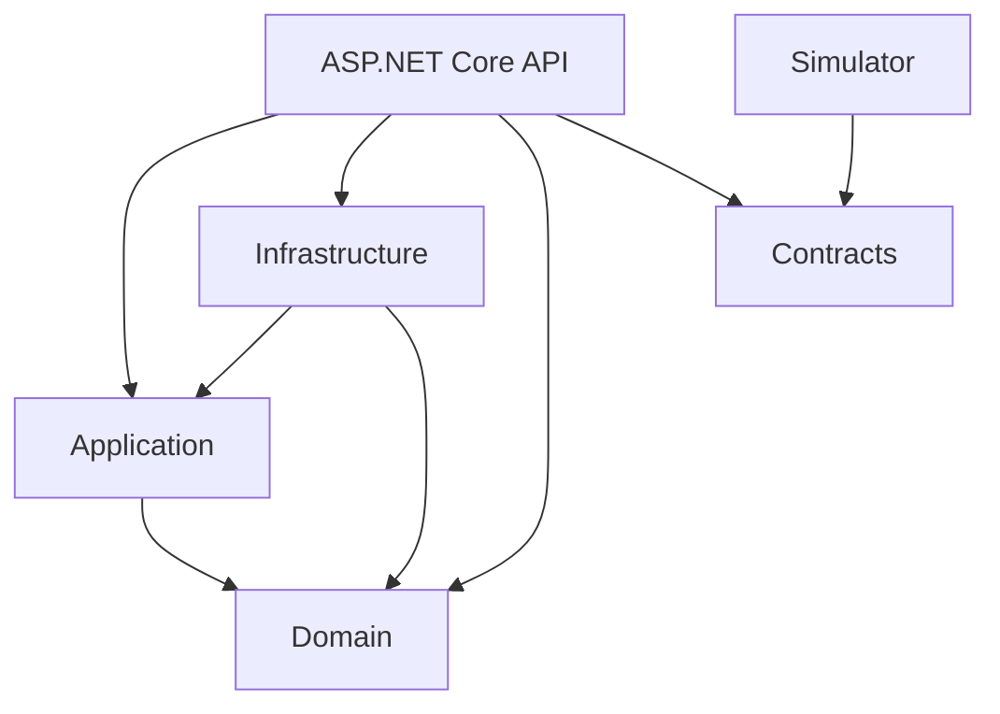

# Architecture and milestone decisions

## Boundaries



Arrows represent C# project references. Domain and Contracts have no project or
package dependencies. Application has no framework dependencies. Infrastructure
implements application storage boundaries. SignalR types
stay in the API. The simulator cannot access backend state or domain rules.

Application owns `TrackingService` and `ITrackingStore`. Infrastructure supplies
`InMemoryTrackingStore`; Contracts holds telemetry requests and snapshot responses.
Domain validates immutable GPS samples, including finite values and explicit units.
Controllers map transport data and delegate processing to Application.
All concrete API controllers inherit `[ApiController]` and the shared
`api/[controller]` route from abstract `BaseApiController`. Actions retain their
HTTP verb and resource-specific suffix attributes. URLs remain `/api/health`,
`/api/vehicles` and `/api/vehicles/{id}/samples`; method names are not URL segments.
Response formatters select JSON or ProblemDetails content types without a global
`Produces` override. Shared client URL constants remain in Contracts.
The sample controller maps requests to an application command and delegates to
`TrackingService.SubmitSampleAsync`. That operation validates domain sample creation
and returns a typed acceptance result. API mapping extensions translate snapshots
and acceptance results into transport DTOs and HTTP responses. Domain validation
bounds/messages and API response messages live in constants owned by their layers.
`TaskExtensions.ToOkResult` supports both plain values and asynchronous results.
Both GET controllers use it. Reads stay synchronous; ingestion awaits best-effort
publication after storing a sample. Ingestion retains 204 and errors retain their
ProblemDetails status.
Startup tracking validation messages and count/threshold limits live in
`TrackingValidationConstants`; coordinate limits reuse domain constants.
The built-in `UseExceptionHandler` middleware runs before CORS and controllers,
using the registered ProblemDetails service for unexpected request failures.
It returns generic 500 responses in Development and Production while framework
logging retains exception diagnostics. Expected 400/404/409 results keep their
explicit mappings. No custom exception middleware or duplicate logging is needed.

All application projects live under `src/`; the solution and repository-wide
configuration remain at the root:

```text
src/
  GpsTracking.Domain/
  GpsTracking.Application/
  GpsTracking.Infrastructure/
  GpsTracking.Api/
  GpsTracking.Contracts/
  GpsTracking.Simulator/
  gps-tracking-web/
docs/
GPS-Vehicle-Tracking-Simulator.sln
```

This is a pragmatic Clean Architecture variant. Domain holds business concepts
and rules. Application owns use cases and the interfaces those use cases need.
Infrastructure implements those interfaces. API is the delivery layer and
composition root: it registers Infrastructure implementations, while controllers
delegate business operations to Application. Neither Domain nor Application
references API, Infrastructure, HTTP, SignalR or persistence frameworks.

Contracts contains transport DTOs shared by the API and simulator; it must not
become a home for business logic or a dependency of Domain. The simulator and
Angular UI are independent clients. Future rule tests belong under a root
`tests/` directory when the corresponding behavior is implemented.

The API's Infrastructure reference is needed for composition, not permission for
controllers to bypass Application. Dependency direction defines the architecture;
the consistent directory layout makes it easier to navigate. No mediator or
CQRS framework is required to maintain these boundaries.

## Current behavior

Each host owns a service-registration extension named `AddServiceCollection`.
Options binding and validator registration
live in these extensions. HTTP middleware and endpoint mapping stay visible in
the API's `Program.cs`. Composition remains in the hosts so the inner layers do
not require dependency-injection framework packages.

Stable API identifiers live in `GpsTracking.Api/Constants/ApiConstants.cs`;
frontend display constants live in `gps-tracking-web/src/app/core/constants/`.
Constants belong to their owning layer. Configuration section names remain with
their options types. URLs, vehicle settings and seed definitions remain in
configuration so constants do not prevent runtime configuration in later milestones.

Custom startup summary logging is omitted. Standard host lifecycle and error logs
remain enabled; `ValidateOnStart` still rejects invalid configuration in both
hosts. No ORM is selected or installed: M1 uses in-memory storage, and database
persistence remains outside the agreed scope.

- The API binds and validates two vehicle definitions, their independent initial
  settings, and two geofence rectangles. It exposes health, development OpenAPI,
  ingestion and snapshots. Settings and geofences remain seed definitions.
- Domain records represent seed values without depending on ASP.NET Core or
  configuration packages. API options and validators own startup binding.
- The simulator's .NET generic host validates its backend URL, minimum interval,
  and two distinct IDs. It runs independent asynchronous loops, advancing routes
  by monotonic elapsed time with UTC timestamps. HTTP timeout is five seconds;
  failed samples are skipped without retries or catch-up bursts.
- Angular uses typed HTTP services, a SignalR connection service and a signal-backed
  store. Initial connection and reconnection trigger REST synchronization with a
  five-second timeout. Failures preserve displayed data and trigger retries.
  There is no regular snapshot polling. SVG markers use distinct colors
  and heading arrows within fixed demo bounds. No stop status is inferred.

Frontend feature services use the shared `ApiService` in `core/services` for
GET/POST/PUT/PATCH/DELETE requests. `TrackingApiService` owns tracking endpoints and
response types. The shared wrapper preserves HttpClient errors and body handling,
including FormData, without forcing headers or adding retries. Synchronization and its
timeout/error presentation remain owned by `TrackingStore`. Extend this wrapper
when a future feature requires additional HTTP capabilities.
Frontend application error messages live in `core/constants/error-messages.constants.ts`.
Use named constants for validation messages and limits when forms are introduced;
the current dashboard has no form validators. Request timeouts and map bounds
already live in tracking constants. Backend error bodies remain unmodified by
the shared HTTP wrapper.

`POST /api/vehicles/{id}/samples` accepts timestamp, latitude, longitude, speedKmh
and heading. The route is the sole vehicle identifier. Success is 204; invalid
payloads return 400, unknown vehicles 404 and non-newer timestamps 409, using
ProblemDetails. Supplied speed and heading remain authoritative.

The singleton store retains raw samples under a separate lock per vehicle.
Timestamp acceptance, append, receipt time and revision increment are atomic.
Reads return immutable snapshot copies, with null latest data before the first
sample. Snapshots are individually consistent, not a transaction across vehicles.
Raw history has no public endpoint in M1. Backend restart clears the session;
browser refresh reads the existing session.

### M2 live synchronization

`AppendWithSnapshot` captures the accepted vehicle revision under the storage lock.
Application publishes that immutable snapshot through `ITrackingPublisher` after
the lock is released. The API's SignalR adapter broadcasts `VehicleUpdated` through
`IHubContext<TrackingHub>`, with a five-second cancellation timeout, and logs transport
failures without undoing telemetry. There is no durable event queue or replay.

`GET /api/vehicles` returns `{ sessionId, vehicles }`; a live event contains
`{ sessionId, vehicle }`. The process-lifetime session UUID is shared by REST and
SignalR. Revisions are comparable only within one session. This changes the M1
snapshot response shape; simulator POST payloads are unchanged.

The frontend registers handlers before connecting, connects before reading REST,
and buffers the newest event per vehicle/session while REST is pending. It merges
only newer revisions, replaces state when REST identifies a new session, and
ignores events from another session. Reconnection cancels old requests and starts
fresh synchronization. Failed REST requests retry after two seconds; initial
connection failures retry separately from SignalR's automatic reconnect policy
(0, 2, 5, then 10 seconds repeatedly). Stop cancels requests/timers and detaches
event handlers; identity/generation guards ignore obsolete asynchronous callbacks.
Live connection state is separate from vehicle freshness; M2 does not infer stops
or mark stationary data as stale.

## Communication and startup

Each application starts independently. The API no longer launches, builds or
references the frontend. The solution includes the frontend for IDE navigation,
but its JavaScript project does not install or build npm dependencies during a
.NET build. Run frontend checks explicitly.

Local HTTP is deliberate: API `http://localhost:5078`, frontend
`http://localhost:4200`. The Angular development proxy forwards `/api/**` and
forwards `/hubs/**` WebSocket traffic to the live tracking hub. The explicit
frontend-origin CORS policy permits credentials for SignalR's default transport
behavior; wildcard origins are not allowed. No authentication or external map keys
are configured. Hosted deployment is out of scope.

Simulator ingestion and snapshots use HTTP; future history/settings use REST;
live publication uses SignalR in M2. A broker, database, authentication, MediatR,
generic repositories and separate read/write stores are unnecessary for this
two-vehicle assessment. Business rules will be ordinary C#.

## Versions and reproducibility

- .NET SDK 10.0.402 is selected by `global.json`, with prereleases and roll-forward
  disabled. All C# projects inherit `net10.0`, nullable references and implicit
  usings from `Directory.Build.props`.
- Direct .NET package versions are explicit; `packages.lock.json` files preserve
  resolved dependencies. `dotnet restore --locked-mode` checks reproducibility.
- Angular/CLI/build tooling 22.2.3, TypeScript 6.0.3, Node 24.19.0 and npm 11.17.0
  are the selected frontend baseline. Use `npm ci` with the committed lockfile.
- SignalR's JavaScript client is pinned to 10.0.11. The server implementation is
  supplied by the ASP.NET Core shared framework, without another server package.
- The starter was small enough to adapt its NgModule/bootstrap configuration
  directly. The new `@angular/build` tooling replaces the deprecated Webpack
  package; the existing Karma/Jasmine test remains.
- ASP.NET Core OpenAPI 10.0.13 resolves Microsoft.OpenApi 2.12.2, removing the
  earlier 2.0.0 restore warning without a redundant direct transitive reference.

Sources: [Angular compatibility](https://angular.dev/reference/versions),
[SDK selection](https://learn.microsoft.com/en-us/dotnet/core/tools/global-json),
[OpenAPI advisory](https://github.com/advisories/GHSA-v5pm-xwqc-g5wc).

## Configuration and limitations

Startup validation rejects missing/duplicate identifiers, an incorrect vehicle
count, non-finite or non-positive settings, invalid rectangle bounds, an invalid
frontend origin, an invalid simulator URL and reporting intervals below 10 seconds.
The rare faster-reporting exception is intentionally unused by the default demo.

The API and simulator have separate configuration files to avoid a runtime or
project dependency between processes. Vehicle IDs and the backend URL must be
kept consistent. Runtime settings and rule evaluations are future work. In-memory
raw history is unbounded for the short demo; production retention is out of scope.

The evaluator confirmed a globally configurable stop radius (default 10 metres),
route boundaries at stop onset and movement resumption, and full elapsed speeding
windows. M3 will replace the current per-vehicle radius seeds with global settings
and `GET`/`PUT /api/settings`; M5 will apply radius changes to both vehicles' pending
stop state. Speed limit and speeding/stop durations remain per vehicle. No M1 code
implements these rules. Fixed stop anchors and geofence initialization remain
implementation defaults rather than separately confirmed requirements.

Local delivery and the HTTP/SignalR architecture are accepted. Persistence is
optional; keep the in-memory implementation without an ORM or Docker. Simulator
buffering/replay after backend outages is explicitly excluded. Failed observations
are skipped; frontend reconnect reloads only state actually held by the backend.
