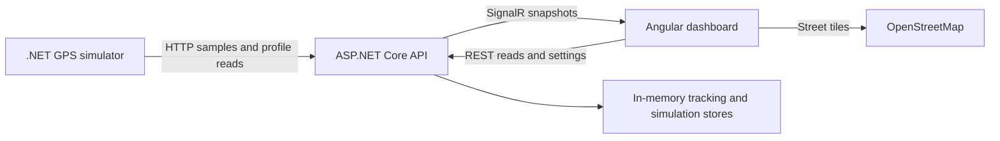

# Architecture and behavior

The application runs as three independent processes: the .NET simulator sends
GPS observations to the API; Angular receives state and renders the dashboard.
Setup is in [README](../README.md); operational configuration and checks are in
[setup](setup.md).

## Project responsibilities

| Project / directory | Responsibility |
| --- | --- |
| `GpsTracking.Domain` | GPS models, validation, speeding, geofence and stop/route rules. No project or package dependencies. |
| `GpsTracking.Application` | Command/query handlers and storage/publication interfaces. References Domain. |
| `GpsTracking.Infrastructure` | In-memory tracking and simulation-profile stores. References Application and Domain. |
| `GpsTracking.Contracts` | HTTP/SignalR DTOs, endpoint constants and default simulation profiles shared with the simulator. No project or package dependencies. |
| `GpsTracking.Api` | HTTP controllers, SignalR, configuration validation and dependency injection. Composes Application, Infrastructure, Domain and Contracts. |
| `GpsTracking.Simulator` | Independent vehicle loops and HTTP delivery. References Contracts; cannot access backend storage or domain rules. |
| `gps-tracking-web` | Angular dashboard and Leaflet map, installed and built with npm. |
| `GpsTracking.Tests` | Backend unit/integration tests, including API, concurrency and simulator scenarios. Frontend tests live beside Angular components/services. |

All six .NET application projects are used by the running demo. The solution
also includes the backend test project and a frontend `.esproj` entry for IDE
navigation. The frontend uses its own `package.json`; the IDE entry does not
install npm dependencies or build Angular during a .NET solution build.
The optional `.run/` configurations are launch shortcuts, not runtime dependencies.

This is a small Clean Architecture implementation with lightweight CQRS:
commands change state, queries read it, and controllers delegate business rules.
There is no mediator framework, broker, ORM or separate read database.

## Processing and synchronization

A telemetry request supplies a timestamp, latitude, longitude, speed in km/h and
heading in degrees. The route identifies the vehicle. Samples must have finite,
in-range values and a strictly newer timestamp than that vehicle's last sample.
Successful ingestion returns 204; invalid data returns 400, an unknown vehicle
404 and an old/duplicate timestamp 409. Expected errors use ProblemDetails;
unexpected exceptions return a generic 500 and are logged by ASP.NET Core.

The singleton tracking store serializes samples, settings changes, rule updates,
revisions and snapshot capture under a shared lock. Handlers are scoped; stores,
clock, session ID and publisher are shared. SignalR publication happens after
commit, outside the lock. Publication failure does not undo accepted data.

REST snapshots and events carry an API session ID and per-vehicle revisions.
Angular connects and buffers live events, loads REST state, then merges newer
revisions and deduplicates alerts by ID. Reconnection resynchronizes state;
a new session replaces old history, settings and map overlays. Updates can arrive
out of order, so delivery order is not used as state order. There is no durable
event queue or exactly-once delivery guarantee.

The simulator has independent loops for both vehicles. Each cycle reads the
vehicle's profile and submits a current sample at intervals of at least ten
seconds. Failed reads retain the current profile; failed submissions are logged
and discarded. Fresh observations continue when the API returns. No backlog is
buffered or replayed.

## Rule assumptions

| Rule | Behavior |
| --- | --- |
| Speeding | Supplied speed is authoritative. Every observation in the qualifying window must be strictly above the limit. A 30-second window needs full elapsed coverage, e.g. 00/10/20/30 seconds. One alert per episode, rearmed when speeding breaks. |
| Geofences | Predefined rectangles include their edges. Three observations initialize membership without an alert; two of the latest three confirm later entry/exit. No crossing is inferred between observed positions. |
| Stops | Distance from a fixed anchor is calculated in metres. Points within the global radius, including its boundary, build a stop candidate. GPS elapsed time confirms a stop; reported speed does not determine it. |
| Routes | A confirmed stop closes the driven route at stop onset. Movement outside the stopped anchor starts a new route. Stationary observations remain in raw history; separate routes are never joined by a line. An initially stationary vehicle has no completed driven route. |
| Live settings | Speed limit and speeding/stop durations are per vehicle; stop radius is global. Saving reevaluates retained qualifying data and unfinished stop state immediately. Historical alerts and completed route boundaries remain fixed. Concurrent edits use last-write-wins. |
| Time and gaps | Business rules use accepted GPS timestamps, not browser timers. A later observation can provide elapsed coverage across a gap; that does not prove continuous physical movement during missing samples. |

For example, reducing a speeding duration from 30 to 15 seconds after 20 seconds
of qualifying observations can alert immediately, using the latest GPS timestamp.
If new settings invalidate the active episode, it can rearm; otherwise the existing
alert latch prevents duplicates. Reducing the stop radius can resume movement at
the latest observed point if it falls outside the confirmed stop's anchor.

## Simulator and presentation

Vehicles repeat deterministic driving, speeding, stationary and resumed-driving
phases. Coordinates advance by elapsed time along predefined straight segments.
Speed changes are instantaneous. Paths are not matched to roads and may cross
buildings on the map. Restarting only the simulator resets its scenario and can
cause a jump in an existing API session; restart both for a repeatable demo.

Leaflet displays geofence rectangles, each route as its own polyline, and the
latest sample as a colored heading marker. A line needs at least two points.
Updates preserve pan/zoom; the overview button fits current overlays. API-provided
names are inserted as plain text. The map releases its listeners and resize
observer when the component is destroyed.

Street-map failures are separate from tracking connectivity: overlays and vehicle
cards keep updating, with a retry action for tiles. The UI marks telemetry stale
after 30 seconds without receipt, assuming synchronized browser/API clocks.
Staleness does not invent a stop or change the last reported movement state.

## API entry points

The [Development OpenAPI document](http://localhost:5078/openapi/v1.json) describes
HTTP payloads. Main endpoints are:

- `POST /api/vehicles/{id}/samples` — ingest a GPS observation.
- `GET /api/vehicles` — session, vehicles, global settings and geofences.
- `GET /api/vehicles/{id}/history` and `/segments` — raw observations and separate routes.
- `GET /api/alerts` and `/api/geofences` — alert history and zone definitions.
- `GET`/`PUT /api/vehicles/{id}/settings` and `/api/settings` — vehicle/global thresholds.
- `GET`/`PUT /api/vehicles/{id}/simulation` — per-vehicle simulation profile.
- `/hubs/tracking` — SignalR `VehicleUpdated` and `GlobalSettingsUpdated` events.

Angular's development proxy forwards `/api/**` and `/hubs/**` to the local API.
The API permits the configured frontend origin with credentials for SignalR.
Startup defaults, external-map requirements and storage limits are documented
in [configuration and verification](setup.md).
